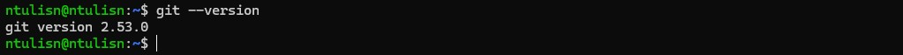
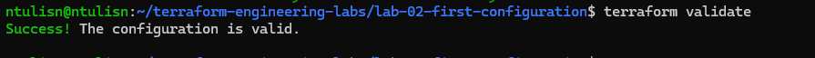
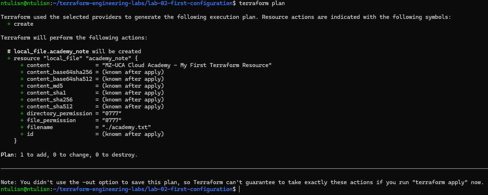

## Lab 01: Environment Check Report

- **Name:** Sandile Ntuli
- **Operating System:** Linux / Ubuntu (WSL)
- **Terraform Version:** v1.16.5
- **Git Version:** 2.53.0
- **Date Completed:** 10 October 2026

## Installation & Environment Notes
- **Problems Encountered:** Initially encountered a `CommandNotFoundException` when trying to use the Linux `touch` command inside a native Windows PowerShell environment. Later faced remote branch tracking errors (`fatal: 'origin' does not appear to be a git repository`) and a non-fast-forward push rejection due to misspelled file tracking duplicates (`envirnment.md`).
- **Resolutions:** Switched to a standard Linux bash terminal environment where `touch` works perfectly. Linked the remote GitHub repository URL securely using `git remote add origin`, synchronized histories via branch alignment pulls, and ran a targeting git cleanup to purge untracked typos.

## Verification Screenshots

Confirms the Terraform version installed and up to date and to avoid compatibility issues with your existing infrastructure

Confirming that Git is installed on your system is a crucial step before using it for version control.

## Execution & Build Verification

### Terraform Validation

It confirms successful validation of all configuration files.

### Terraform Plan

It verifies that Terraform compared the configuration with the current state and outlined the actions it would take.

### Final Execution Results

## Main.tf

Thi
